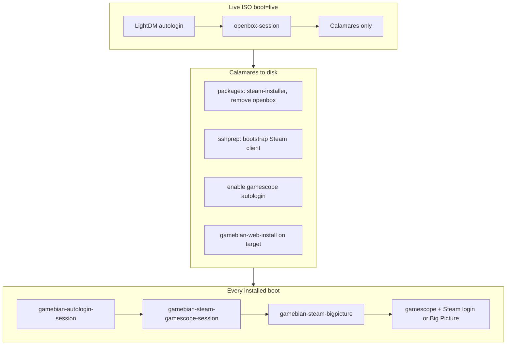

# GamebianOS / GamebianUbuntu

**GamebianOS** is Debian built for one job: install once, then boot like a console into **Steam Big Picture** inside **gamescope**. Same packages and mirrors as Debian. The installed system has no desktop environment.

**GamebianUbuntu** is the Ubuntu-based sibling: the same gamescope + Steam console, built on **Ubuntu 26.04 LTS (Resolute Raccoon)** instead of Debian trixie.

Think of either image as a **game console appliance**: Calamares installs Steam during setup, then every boot autologins into **Steam** inside **gamescope**. Sign-in happens in Steam’s own UI. There is no desktop session and no Switch to Desktop.

It is still **Debian underneath** — same packages, mirrors, and tooling you already know — with Calamares on the live ISO and LightDM + gamescope on the installed disk.

## What it is

- **Debian underneath** — same packages, mirrors, and tooling you already know from Debian.
- **Installer, not a desktop** — the live ISO uses Openbox only as a window for Calamares. That package is removed from the installed disk.
- **Appliance-style flow** — Calamares installs the Steam package and bootstraps the client into the new user’s home. First boot is gamescope + Steam’s login screen.

## What you get

| Stage | Experience |
|-------|------------|
| **Live ISO** | Openbox hosts Calamares only (`live` / `live`, autologin). If there is no network, a NetworkManager dialog opens so Wi-Fi can be configured. |
| **Install** | Calamares apt-installs Steam and downloads the client (`xvfb-run`, up to 10 minutes). Gamescope autologin is enabled before the installer finishes. |
| **Everyday use** | Autologin into gamescope running Steam (`-gamepadui`, `-steamos3`). Sign in inside Steam. If Steam exits, the session restarts it. |

Optional **gamebian-web** (`:8844`) is installed on the target for remote ROM/store setup. The controller quick menu is not started.

## Who it’s for

- A **dedicated gaming PC** or handheld you treat like a console.
- Anyone who wants **Steam on Debian** without hand-rolling gamescope, i386, contrib/non-free, and session glue.
- Tinkerers who still want **real Debian** under the hood.

## Quick start (build the ISO)

**Debian (GamebianOS):**

```bash
cd Build/gamebian-iso
./setup.sh
./build.sh    # or: sudo lb build from GAMEBIANOS_BUILD_ROOT
```

Default build output: `/home/khinds/gamebianos-build-iso` (override with `GAMEBIANOS_BUILD_ROOT`).

**Ubuntu (GamebianUbuntu):**

```bash
cd Build/gamebian-iso-ubuntu
./setup.sh
./build.sh    # sudo lb build from GAMEBIANUBUNTU_BUILD_ROOT
```

Default build output: `/home/khinds/gamebian-ubuntu-build-iso` (override with `GAMEBIANUBUNTU_BUILD_ROOT`).

**Slim live ISO (<2GB):** no Steam/i386, RetroArch, flatpak, or gamebian-web Python stack on the squashfs; no panel, file manager, or desktop theme. `gamescope-build` toolchain is not in package-lists (apt `gamescope` only on Ubuntu). Calamares installs Steam onto the disk and bootstraps the client. Squashfs uses xz (mksquashfs xz has no compression-level option).
Build host for Ubuntu: Ubuntu 26.04 (resolute) recommended. On Debian, install `ubuntu-keyring` for debootstrap.

Branding PNGs for both profiles: edit `Build/images/` then re-run `./setup.sh` in either profile directory.

Distro-specific naming, live-build options, and `/etc/gamebian/distro.conf` values live in **`Build/metadata/`** (`debian.env` / `ubuntu.env`). Both `setup.sh` scripts source their profile env and stage the matching `*.distro.conf` onto the ISO.

## Debian vs Ubuntu

Canonical diff table (build-time keys, feature flags, runtime `distro.conf`): **`metadata/README.md`**.

| | GamebianOS (Debian) | GamebianUbuntu |
|---|---|---|
| Base | Debian trixie | Ubuntu 26.04 LTS resolute |
| Profile dir | `gamebian-iso/` | `gamebian-iso-ubuntu/` |
| Build root env | `GAMEBIANOS_BUILD_ROOT` | `GAMEBIANUBUNTU_BUILD_ROOT` |
| Steam package | `steam-installer` | `steam-installer` (fallback `steam`, multiverse) |
| gamescope | Source build on ISO | **apt** (source fallback) |
| APT gaming repos | contrib + non-free | universe + multiverse |
| RetroArch list | `debian-retroarch.list` | `ubuntu-retroarch.list` |
| Calamares installer | `calamares-install-debian` | `calamares-install-gamebian` |

GamebianUbuntu was forked from GamebianOS; Debian-specific paths were replaced for Ubuntu resolute. Overlay hooks, Calamares modules, and some session scripts still differ per profile — see `metadata/README.md` (still profile-specific).

## Repository layout

| Path | Role |
|------|------|
| `Build/metadata/` | Profile env (`debian.env`, `ubuntu.env`) and runtime `*.distro.conf` — see `Build/metadata/README.md` |
| `Build/images/` | Shared branding PNGs (Calamares, live, installed, GRUB, icons) |
| `Build/gamebian-iso/` | Debian trixie live-build profile: `overlay/`, `hooks/`, package lists |
| `Build/gamebian-iso-ubuntu/` | Ubuntu resolute live-build profile |
| `Build/gamebian-iso/setup.sh` | Source `debian.env`, merge overlay into `GAMEBIANOS_BUILD_ROOT`, stage `/etc/gamebian/distro.conf` |
| `Build/gamebian-iso/build.sh` | Run `lb build` (Debian; build root from `debian.env`) |
| `Build/gamebian-iso-ubuntu/setup.sh` | Source `ubuntu.env`, merge overlay into `GAMEBIANUBUNTU_BUILD_ROOT`, stage `/etc/gamebian/distro.conf` |
| `Build/gamebian-iso-ubuntu/build.sh` | Run `lb build` (Ubuntu; build root from `ubuntu.env`) |
| `Build/gamebian-iso/calamares/` | Debian Calamares modules, branding, installer helpers |
| `Build/gamebian-iso-ubuntu/calamares/` | Ubuntu Calamares install pipeline (partition, mount, unpackfs, …) |
| `Build/share/gamebian/` | Controller menu (shared) |
| `Build/gamebian-iso/ensure-apt-contrib-nonfree.sh` | Debian APT contrib/non-free helper |
| `Build/gamebian-iso-ubuntu/ensure-apt-gaming-repos.sh` | Ubuntu APT universe/multiverse helper |
| `Packages/gamebian-web/` | Web UI source (staged on ISO, installed by Calamares) |
| `scripts/gamebian-sync-installed.sh` | Push overlay changes to an installed system for testing |

## The complete journey (build → live ISO → installed console)

This is the full story of how **GamebianOS** gets from source tree to a gaming appliance.

### Step 0 — Build the hybrid ISO

From `Build/gamebian-iso/`:

1. **`./setup.sh`** — Runs `lb config` for **Debian trixie**, merges `overlay/` (package lists, hooks, `includes.chroot` files), copies Calamares branding/modules from `gamebian-iso/calamares/`, stages `Packages/gamebian-web` at `/usr/src/gamebian-web` on the squashfs, generates color themes, and resets the live-build chroot.
2. **`./build.sh`** — Runs `sudo lb build` in `GAMEBIANOS_BUILD_ROOT` (default `/home/khinds/gamebianos-build-iso`). Output is a **hybrid ISO** you can dd to USB or boot in a VM.
3. **Hook 997** (during `lb build`, needs network) — Builds **gamescope** from GitHub, then **purges** the build toolchain from the squashfs. RetroArch / libretro / Dolphin are **skipped** on the slim live ISO (installed later by Calamares `gamebian-web-install`). Failures are logged but do not fail the image; missing gamescope sets `/etc/gamebian/steam-without-gamescope`.

The squashfs already contains: LightDM, a bare Openbox window for the installer, **Calamares**, session glue scripts, and (usually) a working `gamescope` binary. **Steam, RetroArch/emulators, and flatpak are not on the slim live ISO** — Calamares installs them onto the target disk (`packages` + `gamebian-web-install` + `gamebian-install-steam`, which also bootstraps the Steam client). **gamebian-web is not running on the live session** — only its source is staged for Calamares. Openbox is removed from the installed disk.

**Slim live ISO (<2GB):** `setup.sh` uses `--apt-recommends false` and xz squashfs compression. Hook 997 builds gamescope then **purges** the `gamescope-build` toolchain. Set `GAMEBIAN_LIVE_INCLUDE_EMULATORS=1` during `lb build` only if you want RetroArch baked into the ISO again.

**Live boot must-haves (both profiles):** package lists explicitly include `user-setup` / `live-tools` / `locales` / `keyboard-configuration` (live-config Recommends) so the `live` user is created; **`xserver-xorg`** (LightDM Recommends — without it LightDM cannot start X and the live ISO drops to a getty); **`squashfs-tools`** (Calamares Recommends — without `unsquashfs`, unpackfs fails); and **`e2fsprogs` / `dosfstools` / `parted`** (Calamares erase-disk needs `mkfs.ext4` / FAT / parted — otherwise install fails creating the root filesystem). Never order an SSH oneshot `Before=ssh.socket` and then `systemctl start ssh.socket` — that deadlocks boot (`gamebian-live-sshd-boot.service` removed; `gamebian-sshd-installed-enable.service` only enables the socket, with `TimeoutStartSec=30`). `gamebian-sshd-live-prep.service` + `ssh.socket` remain.

### Step 1 — Boot the live ISO

| What happens | Detail |
|--------------|--------|
| Kernel cmdline | `boot=live` → every session script treats this as **live mode** |
| LightDM | `50-gamebian-live-autologin.conf` autologins user **`live`** / password **`live`** |
| Session | `gamebian-autologin-session` → **`openbox-session`** on live only |
| Installer window | No panel or desktop. **Calamares** autostarts. Offline → `nm-connection-editor` |
| Steam setup | **Skipped on live** — client bootstrap runs in the target chroot during install |
| Installer | Calamares requires **internet** (`welcome.conf`) before install proceeds |

### Step 2 — Calamares installs to disk

Calamares unpacks the live squashfs onto the target partition and runs (in order):

| Module | What it does for Gamebian |
|--------|---------------------------|
| `users` | Creates your user with **`doAutologin: true`** |
| `displaymanager` | Enables LightDM; default session is **`gamebian-steam`** (gamescope) |
| `shellprocess@gamebian-network` | NetworkManager permissions |
| `shellprocess@gamebian-apt-sources` | Enables **i386**, **contrib**, **non-free** |
| `packages` | Installs `steam-installer` (and `gamescope` on Ubuntu); **removes Openbox** and desktop packages |
| `shellprocess@gamebian-sshprep` | Removes live autologin; runs **`gamebian-install-steam`** (apt + client bootstrap under `xvfb-run`); enables gamescope autologin; deletes the copied installer window config |
| `shellprocess@gamebian-gamescope` | Rebuilds gamescope on target if missing (up to 7200s timeout) |
| `shellprocess@gamebian-web` | pip-installs **gamebian-web**, enables `:8844` service |

After install, **`98-gamebian-autologin.conf`** remains: autologin session = **`gamebian-autologin`**. On an installed disk that dispatcher always starts gamescope. sshprep also writes **`99-gamebian-autologin-steam.conf`**. Calamares and Openbox are **removed** from the installed system.

### Step 3 — Steam client during install

`gamebian-install-steam` (inside sshprep, log `/var/log/gamebian-install-steam.log`):

1. Installs `steam-installer` (Ubuntu falls back to `steam`) plus Vulkan drivers.
2. Runs that launcher as the new user under **`xvfb-run`** until `ubuntu12_32/steam` (or `steam.sh`) is present and `.needs-steam-bootstrap` is gone, or **600 seconds** pass.
3. sshprep then runs **`gamebian-enable-steam-lightdm-session`** even if the download did not finish.

Account login is not scripted. If the download fails, the first gamescope boot shows Steam’s own updater.

### Step 4 — First boot is gamescope

On every installed boot, LightDM autologins → **`gamebian-autologin-session`** → **`gamebian-steam-gamescope-session`**. There is no Openbox fallback.

| Check | Result |
|-------|--------|
| Steam launcher missing | Session logs and exits. It does not start a desktop. |
| Client still updating | Steam’s own UI runs inside gamescope |
| Not signed in | Steam’s login screen. `loginusers.vdf` is not required before gamescope starts |
| Steam or gamescope exits | The session waits 2 seconds and starts them again |

`gamebian_steam_kiosk_ready` means the client payload is on disk (no `.needs-steam-bootstrap`). It does **not** require a Steam account.

### Step 5 — Everyday use (gamescope kiosk)

1. `gamebian-autologin-session` → **`gamebian-steam-gamescope-session`** → **`gamebian-steam-bigpicture`**
2. **gamescope** runs as the compositor + Steam with **`-gamepadui -steamos3`**
3. Steam’s **Switch to Desktop** calls `steamos-session-select desktop`, which logs and returns. There is no desktop session.

If gamescope failed at build/install time, **`/etc/gamebian/steam-without-gamescope`** forces Steam on X without the compositor. The session still does not start Openbox.

---

## Building the ISO

This repository holds the live ISO profile, Calamares modules, overlay scripts, and themes.

After `lb build`, verify optional libretro cores on the squashfs:

```bash
# N64 (compiled during hook 997 — needs network + nasm)
grep -E 'verify OK|failed|nasm' /var/log/gamebian-install-mupen64plus-next.log
test -f /usr/lib/x86_64-linux-gnu/libretro/mupen64plus_next_libretro.so

# GameCube / Wii (buildbot download during hook 997)
test -f /usr/lib/x86_64-linux-gnu/libretro/dolphin_libretro.so
```

Hook order (lexicographic): **992** grub branding → **993** bluetooth → **994** gamescope path → **995** apt contrib → **996** inotify → **997** extra packages (gamescope/libretro) → **998** controller menu → **999** icon cache + session chmod → **1000** x-www-browser → **1001** USB wakeup.

Hook **997** logs warnings if cores are missing but does not fail the image build.

```bash
cd Build/gamebian-iso
./setup.sh
./build.sh    # or: sudo lb build from GAMEBIANOS_BUILD_ROOT
```

Default build output: `/home/khinds/gamebianos-build-iso` (override with `GAMEBIANOS_BUILD_ROOT`).

### ISO profile layout

This directory is the **live-build profile** (`overlay/`, `hooks/`, package lists). Calamares modules live in [`calamares/`](calamares/) (Debian) or [`../gamebian-iso-ubuntu/calamares/`](../gamebian-iso-ubuntu/calamares/) (Ubuntu).

**Included on the image (high level):**

- **Live installer:** LightDM + Openbox (Calamares window only). Openbox is removed from the installed disk.
- **Installed session:** LightDM autologin → gamescope + Steam. No panel, file manager, terminal, or desktop theme.
- **Network:** NetworkManager and **mate-polkit**. The live ISO opens `nm-connection-editor` when offline. That GUI is removed from the installed disk.
- **Installer:** **Calamares** on live ISO only; purged from installed disk. **`welcome.conf`** requires internet before install proceeds.
- **SSH:** `openssh-server` + `ssh.socket` enabled on installed target (`shellprocess@gamebian-sshprep`).
- **gamebian-web:** staged on ISO; installed on target by Calamares (`:8844` for ROM/store uploads).
- **Steam / gamescope:** see [Steam / gamescope boot flow](#steam--gamescope-boot-and-session-flow) and [Debian trixie: Steam + gamescope](#debian-trixie-steam--gamescope-gamebian).
- **Hybrid GPU (AMD iGPU + NVIDIA):** auto RADV selection at session start (`gamebian-steam-gamescope-env.sh`); override via `~/.config/gamebian/steam-gamescope.env` (see `steam-gamescope.env.example` in skel).

---

## Steam / gamescope boot and session flow

How the live installer boots, Calamares installs and bootstraps Steam, and the installed disk autologins into gamescope. Matches scripts under `overlay/includes.chroot/`.

### End-to-end flow



**Important:** The installed system never starts Openbox. Legacy drop-ins such as `90-gamebian-openbox-first-session.conf` are only deleted by sshprep.

### Phase 1 — Live ISO

| Component | Path | Role |
|-----------|------|------|
| Live autologin user | `etc/lightdm/lightdm.conf.d/50-gamebian-live-autologin.conf` | `autologin-user=live` (deleted on disk install) |
| Session dispatcher | `usr/local/bin/gamebian-autologin-session` | If `boot=live` → `openbox-session`; otherwise gamescope |
| Installer autostart | `etc/skel/.config/openbox/autostart` | Resolution, polkit, Calamares. Deleted from the installed user |
| Web install (target only) | `calamares/usr/local/sbin/gamebian-web-install` | APT + pip install `gamebian-web` in installed chroot |
| APT sources helper | `usr/local/sbin/gamebian-ensure-apt-sources` | Enables contrib/non-free before Calamares apt steps |

`steam-installer` is installed by Calamares (`packages.conf` + `gamebian-install-steam`), not baked into the slim live squashfs. The same script bootstraps the client into the new user’s home. There is no first-boot terminal.

#### gamescope is not a normal package list entry

**gamescope** is intentionally **not** in `openbox.list.chroot`. On **pure trixie** it is **built from source** (no sid apt). Installed by:

| When | How |
|------|-----|
| ISO build | `hooks/normal/997-gamebian-extra-apt-packages.hook.chroot` → `gamebian-install-gamescope` |
| Disk install | Calamares `shellprocess@gamebian-sshprep` → same script (log: `/var/log/gamebian-install-gamescope.log`) |

See [Debian trixie: Steam + gamescope](#debian-trixie-steam--gamescope-gamebian). If the build fails (no network, missing deps), `/etc/gamebian/steam-without-gamescope` is set and Steam runs **fullscreen on X without gamescope**.

**On an already-installed system:**

```bash
sudo gamebian-install-gamescope
gamescope --help
gamebian-debug-boot-session
```

Remove fallback mode after a successful install:

```bash
sudo rm -f /etc/gamebian/steam-without-gamescope ~/.config/gamebian/steam-without-gamescope
```

### Phase 2 — Fresh disk install

Calamares runs (among others):

1. **`users`** — creates the install user with `doAutologin: true` (writes `autologin-user` for LightDM).
2. **`displaymanager`** — enables LightDM; default session file is `gamebian-steam` (`gamebian-steam-gamescope-session`).
3. **`packages`** — installs Steam and **removes `openbox`**.
4. **`shellprocess@gamebian-sshprep`** — removes live autologin and legacy drop-ins; runs **`gamebian-install-steam`** (package + `xvfb-run` client bootstrap); runs **`gamebian-enable-steam-lightdm-session`**; deletes the installer window config copied from `/etc/skel`.
4. **`shellprocess@gamebian-web`** — runs `gamebian-web-install` on the target.

Persistent overlay config (survives install):

| File | Settings |
|------|----------|
| `98-gamebian-autologin.conf` | `autologin-session=gamebian-autologin`, `user-session=gamebian-steam` |
| `99-gamebian-sessions-directory.conf` | Greeter lists `/usr/share/gamebian/xsessions/` only |

Greeter sessions:

| `.desktop` | Exec | Visible |
|------------|------|---------|
| `gamebian-steam.desktop` | `gamebian-steam-gamescope-session` | Yes — **Steam** |
| `gamebian-autologin.desktop` | `gamebian-autologin-session` | Hidden — internal autologin |

### Phase 3 — Installed boot (gamescope)

1. LightDM autologins → **`gamebian-autologin-session`** → **`gamebian-steam-gamescope-session`**. Live ISO is the only path that still runs Openbox.
2. The session sets `GAMEBIAN_GAMESCOPE_SESSION=1`, sources `/etc/default/gamebian-steam-gamescope` and `~/.config/gamebian/steam-gamescope.env`, starts a polkit agent, then **`gamebian-steam-bigpicture`**.
3. **`gamebian-steam-bigpicture`** runs **gamescope** + Steam with `-gamepadui` and usually **`-steamos3`**. If the client was not fully downloaded during install, Steam’s updater runs here. Sign-in is Steam’s login UI.
4. **`steamos-session-select desktop`** logs “no desktop session” and returns. `gamebian-enable-openbox-lightdm-session` is a no-op.
5. If Steam or gamescope exits, the session restarts them after 2 seconds. If the Steam launcher binary is missing, it logs and exits.

### User marker files

All under `$HOME/.config/` unless noted.

| File | Meaning |
|------|---------|
| `gamebian-firstboot-steam.done` | Written when gamescope autologin is enabled at install |
| `gamebian/in-gamescope-kiosk-session` | Runtime marker while the gamescope session is active |

Shared helpers: `gamebian-steam-ready.sh`, `gamebian-steam-gamescope-env.sh`, `gamebian-steam-kiosk-env.sh`.

### LightDM drop-ins

| File | When present | Purpose |
|------|----------------|---------|
| `50-gamebian-live-autologin.conf` | Live ISO only | `autologin-user=live` — **removed on install** |
| `98-gamebian-autologin.conf` | Always (overlay) | `autologin-session=gamebian-autologin`, `user-session=gamebian-steam` |
| `99-gamebian-autologin-steam.conf` | Written by sshprep | Same Steam session; confirms gamescope autologin after install |
| `99-gamebian-sessions-directory.conf` | Always | Restrict greeter session list to `/usr/share/gamebian/xsessions/` |
| `10-gamebian-lightdm-debug.conf` | Always | Extra LightDM logging |

**Legacy (removed on install, never written by current sshprep):**

- `90-gamebian-openbox-first-session.conf`
- `99-gamebian-steam-session.conf` (old name; different from `99-gamebian-autologin-steam.conf`)
- `88-gamebian-openbox-session.conf`, `97-gamebian-autologin-steam.conf`

### Session script catalog

#### `/usr/local/bin`

| Script | Role |
|--------|------|
| `gamebian-autologin-session` | **Main autologin dispatcher** — live → Openbox installer; installed disk → gamescope |
| `gamebian-steam-gamescope-session` | LightDM **Steam** session; restarts gamescope when Steam exits |
| `gamebian-steam-bigpicture` | gamescope + Steam launcher. Logs and exits if `steam` is missing |
| `gamebian-debug-boot-session` | Print effective LightDM config, markers, recent logs (`--full` for extra detail) |
| `gamebian-fix-steam-boot` | Root repair: enable steam session; set markers; clear stale fallback flags |
| `gamebian-controller-menu` | Gamepad quick launcher |

#### `/usr/sbin`

| Script | Role |
|--------|------|
| `gamebian-enable-steam-lightdm-session` | Write `99-gamebian-autologin-steam.conf` (root). Does not require a Steam sign-in |
| `gamebian-enable-openbox-lightdm-session` | No-op. There is no desktop session |
| `gamebian-steam-switch-to-desktop` | No-op. Does not stop gamescope |
| `gamebian-enter-steam-kiosk-session` | Start gamescope + Steam on the current display if it is not already running |

#### `/usr/bin`

| Script | Role |
|--------|------|
| `steamos-session-select` | SteamOS API shim: `desktop` is a no-op; `gamescope` keeps the gaming session |

#### `/usr/share/gamebian`

| Script | Role |
|--------|------|
| `gamebian-steam-ready.sh` | Client-payload checks. `gamebian_steam_kiosk_ready` does not require `loginusers.vdf` |
| `gamebian-steam-gamescope-env.sh` | Source `steam-gamescope.env`; hybrid GPU RADV auto-tune |
| `gamebian-steam-kiosk-env.sh` | Kiosk marker and gamescope process helpers |
| `gamebian-fix-steam-share.sh` | Debian `~/.steam/debian-installation` ↔ `~/.local/share/Steam` symlink |
| `gamebian-session-log.sh` | Append to `~/.cache/gamebian/lightdm-login.log` |
| `gamebian-lightdm-user.sh` | Resolve autologin user home (for root enable scripts) |

`ensure-apt-contrib-nonfree.sh` lives in `Build/gamebian-iso/` (copied onto the ISO by `setup.sh`).

#### systemd / udev

| Unit | Role |
|------|------|
| `lib/systemd/system/gamebian-usb-wakeup.service` | Boot oneshot → `enable-usb-wakeup-all` |
| `usr/lib/systemd/system-sleep/gamebian-usb-wakeup` | `pre` suspend → `enable-usb-wakeup-all` |
| `lib/udev/rules.d/80-gamebian-usb-gamepad-wakeup.rules` | On gamepad connect → `enable-usb-wakeup` |

#### Calamares (build tree)

| Script | Role |
|--------|------|
| `gamebian-web-install` | Target: apt deps, pip install gamebian-web, enable services |
| `gamebian-ensure-apt-sources` | Target: contrib/non-free for apt |
| `shellprocess@gamebian-sshprep` | Target: ssh keys, Steam package + client bootstrap, enable gamescope autologin, drop installer window config |

### Session switching reference

| Action | Mechanism | Affects next boot? |
|--------|-----------|-------------------|
| Steam → Switch to Desktop | `steamos-session-select desktop` logs and returns | No |
| Greeter → Steam | `gamebian-steam` → gamescope session | Current login |
| Autologin | `gamebian-autologin` → gamescope on an installed disk | Yes |

### Steam / gamescope troubleshooting

```bash
# As the autologin user
gamebian-debug-boot-session
gamebian-debug-boot-session --full

# As root — repair markers + LightDM steam preference
sudo gamebian-fix-steam-boot
sudo gamebian-install-gamescope      # if missing after install (needs network)
sudo gamebian-install-steam          # missing steam-installer / sid apt repair
```

**Log files:**

| Path | Content |
|------|---------|
| `~/.cache/gamebian/session.log` | gamescope-session decisions |
| `~/.cache/gamebian/steam-bigpicture.log` | gamescope/steam exec lines |
| `~/.cache/gamebian/lightdm-login.log` | session dispatcher entries |
| `~/.cache/gamebian/session-select.log` | Steam Switch to Desktop (no-op) |
| `~/.cache/gamebian/enter-steam-kiosk.log` | enter-steam-kiosk-session |
| `/var/log/gamebian-install-steam.log` | Apt install + client bootstrap |
| `/var/log/gamebian-install-gamescope.log` | Calamares / manual gamescope install |
| `/var/log/lightdm/lightdm.log` | LightDM autologin / session selection |

Optional tuning: copy `etc/skel/.config/gamebian/steam-gamescope.env.example` → `~/.config/gamebian/steam-gamescope.env`:

- `GAMEBIAN_SKIP_GAMESCOPE=1` — VM / broken Vulkan fallback
- `GAMEBIAN_VK_ICD_FILENAMES` — manual RADV on hybrid NVIDIA + AMD
- `GAMEBIAN_GAMESCOPE_HIDE_CURSOR_DELAY` — kiosk mouse hide (default `-C 0` when a USB mouse is plugged in); `GAMEBIAN_GAMESCOPE_NO_HIDE_CURSOR=1` to disable

---

## Debian trixie: Steam + gamescope (Gamebian)

Gamebian ISOs use **Debian trixie only** for apt — **no sid mixing** (that broke `steam-installer` / `libgpg-error0:i386`).

### ISO / live-build

| Step | What |
|------|------|
| `package-lists/gamescope-build.list.chroot` | `meson`, `ninja`, `git`, gamescope `-dev` deps on squashfs |
| `hooks/normal/997-gamebian-extra-apt-packages.hook.chroot` | Runs `gamebian-install-gamescope` (clone + meson + install) |
| Log | `/var/log/gamebian-install-gamescope.log` inside the chroot during build |

**`lb build` needs network** while hook 997 runs (git clone GitHub). Default tag: **`GAMEBIAN_GAMESCOPE_GIT_REF=3.16.22`**.

After a successful ISO build, the live and installed images should report:

```text
gamescope --help
# [gamescope] [Info]  console: gamescope version 3.16.22+ds-1 ...
```

### Steam package

- Package: `steam-installer` (non-free + **i386**)
- Install: Calamares runs `gamebian-install-steam` (package + client bootstrap). Repair later with `sudo gamebian-install-steam`.
- Requires: `dpkg --add-architecture i386`, contrib + non-free

### gamescope install

**Not** installed from sid `.deb` or apt pins.

| Method | When |
|--------|------|
| **trixie apt** | If `gamescope` appears in trixie — tried first |
| **Build from source** | Default — `gamebian-install-gamescope` |

Source build (same as manual flow):

```bash
sudo gamebian-install-gamescope
# or: GAMEBIAN_GAMESCOPE_GIT_REF=3.16.22 sudo gamebian-install-gamescope
```

The script:

1. Disables any legacy `gamebian-sid-install.list` / `gamebian-gamescope-from-sid` pin files
2. `apt build-dep gamescope` + build packages from trixie
3. `git clone https://github.com/ValveSoftware/gamescope.git`
4. `git submodule update --init --recursive`
5. `meson setup build --prefix=/usr` → `ninja -C build install`

Logs on install: `/var/log/gamebian-install-gamescope.log` (Calamares sshprep).

#### Fallback

If the build fails (no network, missing deps, VM GPU):

- `/etc/gamebian/steam-without-gamescope` is created
- LightDM **Steam** session runs **fullscreen Steam on X** (no compositor)

### Recommended order on a VM

1. `sudo gamebian-install-steam` (unmixes sid pins and aligns i386 if needed)
2. `sudo gamebian-install-gamescope` (needs network + ~10–20 min compile)
3. `gamescope --help`
4. First-boot Steam / reboot → **Steam** session

### Other Debian releases (reference)

| Suite | Steam + gamescope from apt alone |
|-------|--------------------------------|
| bookworm | Both in one suite (gamescope 3.11) |
| trixie | Steam yes; gamescope **source build** (this section) |
| sid only | Both in apt; whole OS unstable |

### Recovery after old sid experiments

```bash
sudo ../../scripts/repair-apt-for-steam.sh   # dev tree → gamebian-install-steam on target
sudo gamebian-install-gamescope
```

---

## Script reference

Overlay scripts live under `overlay/includes.chroot/`. Paths below are **on the image** (omit `overlay/includes.chroot` from overlay paths).

### Session and LightDM (`/usr/local/bin`, `/usr/sbin`)

| Path | Description |
|------|-------------|
| `/usr/local/bin/gamebian-autologin-session` | **Main autologin dispatcher.** Live ISO (`boot=live`) → Openbox installer. Installed disk → gamescope. |
| `/usr/local/bin/gamebian-steam-gamescope-session` | LightDM **Steam** session: kiosk env, polkit agent, then `gamebian-steam-bigpicture`. Restarts on exit. |
| `/usr/local/bin/gamebian-steam-bigpicture` | Runs gamescope + Steam (`-gamepadui`, `-steamos3`). No desktop fallback. |
| `/usr/sbin/gamebian-enable-steam-lightdm-session` | **Root:** write `99-gamebian-autologin-steam.conf`. Called at the end of install. |
| `/usr/sbin/gamebian-enable-openbox-lightdm-session` | No-op. The installed system has no desktop. |
| `/usr/sbin/gamebian-enter-steam-kiosk-session` | Start gamescope + Steam on the current display if it is not already running. |
| `/usr/sbin/gamebian-steam-switch-to-desktop` | No-op. Does not stop gamescope. |
| `/usr/bin/steamos-session-select` | SteamOS API shim: `desktop` is a no-op; `gamescope` stays on the gaming session. |

### User tools (`/usr/local/bin`)

| Path | Description |
|------|-------------|
| `/usr/local/bin/gamebian-controller-menu` | Python gamepad quick-launcher (Guide / Home). Source: `../share/gamebian/gamebian_controller_menu.py`. |
| `/usr/local/bin/gamebian-debug-boot-session` | LightDM config, markers, gamescope status, logs (`--full` for extra detail). |
| `/usr/local/bin/gamebian-fix-steam-boot` | **Root repair:** enable Steam session, set markers, clear stale gamescope fallback flags. |

### System install helpers (`/usr/local/sbin`)

| Path | Description |
|------|-------------|
| `/usr/local/sbin/gamebian-ensure-apt-sources` | Calamares: enable **i386** + **contrib/non-free** on install target (Steam, libretro). |
| `/usr/local/sbin/gamebian-install-gamescope` | Build gamescope from source on trixie (hook **997**, Calamares); fallback `steam-without-gamescope` on failure. |
| `/usr/local/sbin/gamebian-install-steam` | Install `steam-installer` (Ubuntu: fallback `steam`) and bootstrap the client as the install user under `xvfb-run`. |
| `/usr/local/sbin/gamebian-remove-installed-desktop.sh` | Delete the live installer Openbox config from the installed user and `/etc/skel`. |
| `/usr/local/sbin/gamebian-install-libretro-mupen64plus-next` | **N64** — not in Debian apt; source build on RetroArch 1.20.x (needs **`nasm`**). ISO hook **997** + Calamares. |
| `/usr/local/sbin/gamebian-install-libretro-dolphin` | **GameCube / Wii** — not in Debian apt; downloads `dolphin_libretro.so` from libretro buildbot. ISO hook **997** + Calamares. |

### Shared libraries (`/usr/share/gamebian`)

Sourced by session scripts and installers — not usually run directly.

| Path | Description |
|------|-------------|
| `/usr/share/gamebian/ensure-apt-contrib-nonfree.sh` | Add **i386**; enable **contrib/non-free** (canonical: `Build/gamebian-iso/`). |
| `/usr/share/gamebian/gamebian-apt-unmix-sid.sh` | Stash sid pins/sources; align `libgpg-error0` amd64/i386 for Steam. |
| `/usr/share/gamebian/gamebian-fix-steam-share.sh` | Symlink `~/.local/share/Steam` → `~/.steam/debian-installation` (overlay only; not shipped by gamebian-web pip). |
| `/usr/share/gamebian/gamebian-lightdm-user.sh` | Resolve autologin username and home (root enable-* scripts). |
| `/usr/share/gamebian/gamebian-steam-ready.sh` | Client-payload checks. Kiosk ready does not require `loginusers.vdf`. |
| `/usr/share/gamebian/gamebian-steam-gamescope-env.sh` | Source `steam-gamescope.env`; hybrid GPU RADV auto-tune; clear stale fallback markers. |
| `/usr/share/gamebian/gamebian-steam-kiosk-env.sh` | Kiosk marker and gamescope process helpers. |
| `/usr/share/gamebian/gamebian-session-log.sh` | Append to `~/.cache/gamebian/lightdm-login.log`. |

### RetroArch launcher (`/usr/libexec/gamebian`)

| Path | Description |
|------|-------------|
| `/usr/libexec/gamebian/launcher` | RetroArch front-end for `/usr/bin/<platform>`; **glcore** for N64/GC/etc.; hybrid GPU `DRI_PRIME` when needed. If **dolphin** libretro core is missing but `dolphin-emu` is installed, **GameCube/Wii** fall back to standalone Dolphin. |

Per-platform bins and configs: `../../Packages/gamebian-web/bin/*`, `config/*.cfg`. See [../../Docs/RETRO-PLATFORMS.md](../../Docs/RETRO-PLATFORMS.md).

### USB gamepad wake

| Path | Description |
|------|-------------|
| `/usr/libexec/gamebian/enable-usb-wakeup` | Enable `power/wakeup` on USB ancestors of one input device (udev `%p`). |
| `/usr/libexec/gamebian/enable-usb-wakeup-all` | All gamepads + USB root wakeup nodes; used at boot and before suspend. |
| `/usr/lib/systemd/system-sleep/gamebian-usb-wakeup` | Re-apply USB wakeup before suspend. |

### How they connect

```text
Live ISO
  LightDM autologin → gamebian-autologin-session → openbox-session → Calamares

Install
  gamebian-install-steam (apt + xvfb-run client bootstrap)
  gamebian-enable-steam-lightdm-session

Installed disk
  LightDM autologin → gamebian-autologin-session
       → gamebian-steam-gamescope-session
            → gamebian-steam-bigpicture
                 → gamescope + steam
```

**ISO hook 997:** gamescope build + purge of build toolchain. RetroArch cores skipped on slim live ISO.

**Install time (Calamares):** `gamebian-ensure-apt-sources` → apt steam + RetroArch list via `gamebian-web-install` → `gamebian-install-steam` (package and client bootstrap) / `gamebian-install-gamescope` → libretro extras (N64, Dolphin) → enable gamescope autologin.

### Quick commands (installed system)

```bash
gamebian-debug-boot-session          # LightDM session, markers, recent logs
sudo gamebian-fix-steam-boot         # repair LightDM + markers
sudo gamebian-install-gamescope      # missing gamescope
sudo gamebian-install-steam          # missing steam-installer, or retry the client bootstrap
sudo gamebian-install-libretro-mupen64plus-next   # N64 core
sudo gamebian-install-libretro-dolphin          # GameCube / Wii libretro core
../../scripts/gamebian-sync-installed.sh # push overlay + gamebian-web from dev tree
```

**Logs:** `~/.cache/gamebian/session.log`, `steam-bigpicture.log`, `/var/log/gamebian-install-steam.log`, `/var/log/gamebian-install-gamescope.log`, `/var/log/gamebian-install-mupen64plus-next.log`, `/var/log/gamebian-install-libretro-dolphin.log`

### Login credentials

| Boot | Username | Password |
|------|----------|----------|
| Live ISO | `live` | `live` (usually autologin) |
| Installed disk | Calamares **Users** page | Password you set there |

See `/usr/share/gamebian/LOGIN-CREDENTIALS.txt` on the image.

---

## QA checklist (production readiness)

Test matrix for **Live ISO**, **installed disk**, **Steam install during Calamares**, **gamescope autologin**, and **retro libraries**.

### Conventions

- **Target**: bare metal preferred; VM ok for some cases.
- **Autologin routing (installed)**: autologin → **gamescope + Steam**. Sign-in is Steam’s own UI. `loginusers.vdf` is not required before the session starts.
- **Client ready**: `ubuntu12_32/steam` or `steam.sh` under `~/.steam/` or `~/.local/share/Steam/`, and no `.needs-steam-bootstrap`.
- **No desktop**: Openbox is not installed on the target. Switch to Desktop is a no-op.

### Quick state reset

Run as the install user:

```bash
rm -f ~/.config/gamebian-firstboot-steam.done
rm -f ~/.config/gamebian-firstboot-steam.run-finished
rm -f ~/.config/gamebian/in-gamescope-kiosk-session
```

To see Steam’s login UI again, remove or rename `loginusers.vdf`. The session should still be gamescope.

### A. Live ISO boot flow

- **A1 — Live ISO is the installer window**
  - Boot with `boot=live`
  - **Expected:** Openbox autologin; Calamares starts; no panel, terminal, or Steam setup UI. Offline → NetworkManager connection dialog.

### B. Installed autologin routing

- **B1 — Fresh install boots gamescope** — After Calamares, reboot → gamescope + Steam (login or Big Picture). No desktop, no setup terminal, no “waiting for Steam” notifications.
- **B2 — Client downloaded during install** — `/var/log/gamebian-install-steam.log` shows the bootstrap. `ubuntu12_32/steam` or `steam.sh` exists in the user’s Steam directory and `.needs-steam-bootstrap` is absent.
- **B3 — Bootstrap failed or timed out** — Gamescope still starts. Steam’s own updater runs inside the session.
- **B4 — Not signed in** — No `loginusers.vdf`; reboot still enters gamescope and shows Steam’s login UI.
- **B5 — Switch to Desktop** — Steam power menu does not leave gamescope. `steamos-session-select desktop` logs and returns.

### D. Steam install during Calamares

- **D1 — No setup terminal** — First boot does not open a terminal or a “waiting for Steam” notification.
- **D2 — Gamescope autologin is enabled at install** — `/etc/lightdm/lightdm.conf.d/99-gamebian-autologin-steam.conf` exists before the first reboot.
- **D3 — Sign-in is inside Steam** — After reboot, Steam’s login UI appears in gamescope. Signing in writes `loginusers.vdf` without a desktop.

### E. Controller menu

- **E1** — The menu is not started on the installed system (no Openbox autostart, no user unit).

### F. Steam/gamescope kiosk

- **F1** — Reboot → gamescope + Steam gamepad UI (or Steam’s login/updater if the account or client is not ready).
- **F2** — “Switch to Desktop” does not start a desktop. The gamescope session keeps running or restarts Steam.

### G. Web UI (`:8844`)

- **G1** — `http://127.0.0.1:8844` loads on the installed system (from another machine on the LAN, or after SSH).
- **G2** — LAN `http://<target-ip>:8844` reachable (if firewall allows).

### H. RetroArch libraries (installed disk)

- **H1 — Apt cores** — SNES/NES/GBA/Genesis/etc. launch from library after upload (see [RETRO-PLATFORMS.md](../../Docs/RETRO-PLATFORMS.md)).
- **H2 — N64** — `/usr/lib/x86_64-linux-gnu/libretro/mupen64plus_next_libretro.so` exists; `n64` launches a game (re-run `sudo gamebian-install-libretro-mupen64plus-next` if missing).
- **H3 — GameCube / Wii** — `dolphin-emu` Sys symlink via `ngc`/`wii` bins; prefer `dolphin_libretro.so` (install via `sudo gamebian-install-libretro-dolphin`); standalone `dolphin-emu` fallback if core missing.

### Pass/fail gate

Production-ready when **A1**, **B1–B5**, **D1–D3**, **F1–F2**, **G1**, and critical retro paths (**H2–H3** if you ship those platforms) all pass.

---

## Related documentation

- `metadata/README.md` — canonical Debian vs Ubuntu key reference (`*.env`, `*.distro.conf`)
- `images/README.md` — branding PNG layout
- `../../Docs/` — retro platforms, sync scripts (updated for Ubuntu where noted)

---

## In one sentence

**Install once with Calamares — Steam is installed during setup — then GamebianOS or GamebianUbuntu boots straight into gamescope.**
